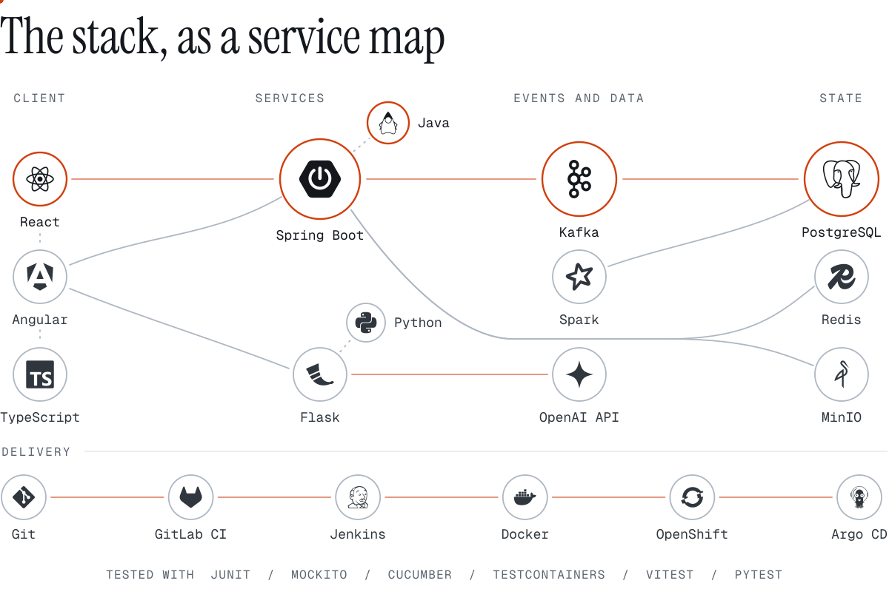

<!-- The images are drawn by scripts/build.mjs from live GitHub data. To change a fact, edit scripts/profile.mjs. -->

<a href="https://github.com/YoussefELALAMI/YoussefELALAMI"><picture><source media="(max-width: 1011px)" srcset="assets/hero-mobile.svg"><source media="(prefers-color-scheme: dark)" srcset="assets/hero-dark.svg"><source media="(prefers-color-scheme: light)" srcset="assets/hero-light.svg"></picture></a>

I build full-stack software in **Toulouse**: Java and Spring Boot on the backend, React and Angular on the front, Kafka and PostgreSQL in between.

At **Sopra Steria** I work on France's national e-invoicing platform, where I automate end-to-end tests across the invoice flows and am the main developer of an internal app that launches test runs from the browser and streams the logs live. Before that, as an apprentice at **Capgemini**, I built Spring Boot and Angular features for **Airbus** product data management. In my own time I'm building **[RoleLens](https://github.com/YoussefELALAMI/role-lens)**.

Right now I'm also going deep on LLMs, from internals to production, and training for a muscle-up, a front lever and a freestanding handstand.

 

<a href="https://www.linkedin.com/in/youssef-el-alami-/"><picture><source media="(max-width: 1011px)" srcset="assets/trace-mobile.svg"><source media="(prefers-color-scheme: dark)" srcset="assets/trace-dark.svg"><source media="(prefers-color-scheme: light)" srcset="assets/trace-light.svg"></picture></a>

 

<a href="https://github.com/YoussefELALAMI?tab=repositories"><picture><source media="(max-width: 1011px)" srcset="assets/work-heading-mobile.svg"><source media="(prefers-color-scheme: dark)" srcset="assets/work-heading-dark.svg"><source media="(prefers-color-scheme: light)" srcset="assets/work-heading-light.svg"></picture></a>

<a href="https://github.com/YoussefELALAMI/role-lens"><picture><source media="(max-width: 1011px)" srcset="assets/rolelens-mobile.svg"><source media="(prefers-color-scheme: dark)" srcset="assets/rolelens-dark.svg"><source media="(prefers-color-scheme: light)" srcset="assets/rolelens-light.svg"></picture></a>

<a href="https://github.com/YoussefELALAMI/guessmoji"><picture><source media="(max-width: 1011px)" srcset="assets/guessmoji-mobile.svg"><source media="(prefers-color-scheme: dark)" srcset="assets/guessmoji-dark.svg"><source media="(prefers-color-scheme: light)" srcset="assets/guessmoji-light.svg"></picture></a><a href="https://github.com/YoussefELALAMI/Plantagon"><picture><source media="(max-width: 1011px)" srcset="assets/plantagon-mobile.svg"><source media="(prefers-color-scheme: dark)" srcset="assets/plantagon-dark.svg"><source media="(prefers-color-scheme: light)" srcset="assets/plantagon-light.svg"></picture></a><a href="https://github.com/YoussefELALAMI/observability-platform"><picture><source media="(max-width: 1011px)" srcset="assets/observability-mobile.svg"><source media="(prefers-color-scheme: dark)" srcset="assets/observability-dark.svg"><source media="(prefers-color-scheme: light)" srcset="assets/observability-light.svg"></picture></a><a href="https://github.com/YoussefELALAMI/coding-challenges"><picture><source media="(max-width: 1011px)" srcset="assets/challenges-mobile.svg"><source media="(prefers-color-scheme: dark)" srcset="assets/challenges-dark.svg"><source media="(prefers-color-scheme: light)" srcset="assets/challenges-light.svg"></picture></a>

 

<a href="https://github.com/YoussefELALAMI?tab=repositories"><picture><source media="(max-width: 1011px)" srcset="assets/map-mobile.svg"><source media="(prefers-color-scheme: dark)" srcset="assets/map-dark.svg"><source media="(prefers-color-scheme: light)" srcset="assets/map-light.svg"></picture></a>

 

<a href="https://www.linkedin.com/in/youssef-el-alami-/"><picture><source media="(max-width: 1011px)" srcset="assets/footer-mobile.svg"><source media="(prefers-color-scheme: dark)" srcset="assets/footer-dark.svg"><source media="(prefers-color-scheme: light)" srcset="assets/footer-light.svg"></picture></a>

<a href="https://www.linkedin.com/in/youssef-el-alami-/"><picture><source media="(prefers-color-scheme: dark)" srcset="assets/button-linkedin-dark.svg"><source media="(prefers-color-scheme: light)" srcset="assets/button-linkedin-light.svg"></picture></a>
<a href="mailto:youssef2003elalami@gmail.com"><picture><source media="(prefers-color-scheme: dark)" srcset="assets/button-email-dark.svg"><source media="(prefers-color-scheme: light)" srcset="assets/button-email-light.svg"></picture></a>

Arabic, French, English (C1+). Off the keyboard: calisthenics and independent travel.

Read this page as plain text

### Experience

**Software Engineer, Sopra Steria** (Jan 2026 to present, Toulouse) 
AIFE's Portail Public de Facturation (PPF), France's national e-invoicing platform. Automated end-to-end scenarios that follow an invoice through the platform; main developer of an internal app that launches test runs from the browser with live logs; GitLab CI pipeline work and the team's CI/CD guide. 
Java, Groovy, Spring Boot, React, TypeScript, Kafka, PostgreSQL, MinIO, GitLab CI, Docker, OpenShift

**Full-Stack Developer (apprenticeship), Capgemini** (Jun 2024 to Oct 2025, Toulouse) 
Airbus PDM Services: Spring Boot REST APIs and Angular screens for product data management, large datasets with Apache Spark, in a SAFe team. 
Java, Spring Boot, Angular, TypeScript, SQL, Apache Spark, JUnit, Mockito, Jenkins

### Education

**M.Eng. in Software Engineering, ENSEEIHT, Toulouse INP** (2022 to 2025)

**DUT in Electrical Engineering and Industrial Computing, IUT Henri Poincaré, Université de Lorraine, Longwy** (2020 to 2022), with an Erasmus semester at Dalarna University, Sweden.

### Projects

- **[RoleLens](https://github.com/YoussefELALAMI/role-lens)** (building now): a Chrome extension and web app that shows how your CV matches each requirement of a job ad. CV upload and the ATS view work today; the match engine is next. Spring Boot, React, TypeScript, PostgreSQL.
- **[GuessMoji](https://github.com/YoussefELALAMI/guessmoji)**: a word game where players decode riddles the OpenAI API writes in emoji. Flask, Angular, OpenAI API, Docker.
- **[Plantagon](https://github.com/YoussefELALAMI/Plantagon)** (team of four): Raspberry Pi sensors stream temperature, soil moisture and light to a live dashboard. Python, Node.js, React.
- **[Mini Observability Platform](https://github.com/YoussefELALAMI/observability-platform)** (early stage): a log ingestion API with Redis idempotency and a PostgreSQL schema. Java, Spring Boot.
- **[HireTrack](https://github.com/YoussefELALAMI/HireTrack-ATS)** (in progress): a recruitment platform backend with JWT auth. Spring Boot, Angular.
- **[Coding Challenges](https://github.com/YoussefELALAMI/coding-challenges)**: LeetCode solutions, mostly in Java.

### Skills

- **Languages:** Java, TypeScript, JavaScript, Python, SQL, Groovy
- **Frontend:** React, Angular, Vite
- **Backend:** Spring Boot, REST, SOAP, Server-Sent Events, Flask, Node.js, OpenAI API
- **Data and messaging:** PostgreSQL, Kafka, Redis, MinIO, Apache Spark
- **Delivery:** GitLab CI, Jenkins, Docker, OpenShift, Argo CD, Git
- **Testing:** JUnit, Mockito, Cucumber, Testcontainers, Vitest, pytest

### Languages

Arabic (native), French (bilingual), English (C1+).

Every image here is drawn from live GitHub data by <a href="https://github.com/YoussefELALAMI/YoussefELALAMI/tree/main/scripts">a small script</a> and <a href="https://github.com/YoussefELALAMI/YoussefELALAMI/blob/main/.github/workflows/redraw.yml">redrawn every Monday</a>. Type: Instrument Serif and Geist.

